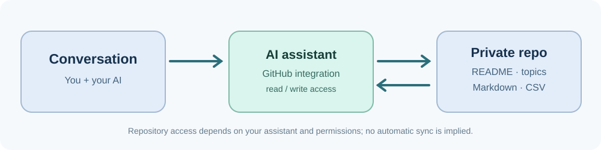

<div align="center">


**Persistent, structured memory for your AI — stored in a GitHub repository you control.**

[](LICENSE)  

[Get started](#-quick-start) · [Setup guide](SETUP.md) · [Copy setup prompt](templates/setup-prompt.md) · [How it works](#-how-it-works)

</div>

---

## The problem

You can spend months working with an AI assistant — tracking fitness, planning trips, refining projects, making decisions — only to discover that **a new conversation doesn't reliably have all that context**.

## The idea

**Keep durable knowledge in your own private GitHub repository.** Use ordinary Markdown files, organize them by topic, and give an AI assistant with GitHub access instructions to read and update them.

- **Your data, your control** — in a private repository you own.
- **Topic-based memory** — each topic has its own README and recording rules.
- **Plain files** — Markdown for notes, CSV for time series.
- **Version history** — Git commits show changes over time.
- **No database or server** — the basic workflow needs neither.
- **Assistant-agnostic format** — use any assistant that can access your repository.

> **Important:** MindRepo is an open template and workflow, **not** an app, a memory service, or automatic synchronization. Reading and writing depend on your assistant's GitHub integration, permissions, and instructions.

## 🚀 Quick start

**You can start with a private copy in three steps:**

1. **[Use this template](https://github.com/florianpenz/mindrepo/generate)** → choose **Private** for your new repository. Do not store personal information in this public template.
2. **Connect your AI assistant to GitHub**, granting it access to your new private repository. Check that reading works before allowing edits.
3. **[Copy the guided setup prompt](templates/setup-prompt.md)** into your assistant, paste it unchanged, and follow the prompts. The assistant will ask for your language and repository name. Your private knowledgebase and generated instructions use your chosen language.

That's it for the initial setup. For ongoing use, add the [project instructions](templates/project-instructions.md) to your AI workspace and verify a small test commit.

**Need more detail?** See the [step-by-step setup guide](SETUP.md).

## 🔄 How it works



A topic might look like this in **your private copy**:

```text
README.md                        # Repository-wide rules
topics/
  fitness/
    README.md                    # What to track and how
    progress.csv                 # Dated measurements
    recipes.md                   # Confirmed recipe references
  travel/
    README.md                    # Travel planning rules
    new-zealand.md               # Plans and decisions
```

The assistant reads the relevant instructions and files when asked or when its configured workflow calls for it. It can save updates **only when a compatible GitHub integration is available and authorized**. You can always inspect the resulting files and commits yourself.

## 📦 What's included

| Resource | What it's for |
| --- | --- |
| [SETUP.md](SETUP.md) | Setup steps, permissions, privacy, and verification |
| [Guided setup prompt](templates/setup-prompt.md) | Start your knowledgebase in a conversation |
| [AI project instructions](templates/project-instructions.md) | Help future chats find and update your repo |
| [Topic README template](templates/topic-readme.md) | Add new knowledge categories consistently |
| [Fictional example](topics/example/README.md) | See a topic in action without personal data |

## 🔐 Privacy and reliability

- **Create a private copy.** Template repositories are not automatically private. Git history can retain deleted information.
- **Never commit secrets**, credentials, or API keys.
- **No fabricated memory.** Distinguish confirmed facts, estimates, and reconstructed notes.
- **Read before writing.** Preserve existing data and document corrections.
- **Direct commits only** for routine knowledgebase updates — no branches, PRs, or force-pushes.
- **No false confirmations.** If an assistant cannot access GitHub or a write fails, it should say so.

MindRepo does **not** guarantee automatic retrieval in every new chat, background syncing, or support in every ChatGPT account or AI tool.

## 🤝 Feedback and contributions

Have an idea to make MindRepo easier to use? Open an issue in this public project. You never need to share your personal knowledgebase.

If you find MindRepo useful, consider **starring the repository** ⭐ — it helps others discover the project.

## 📄 License

[MIT License](LICENSE) · Copyright © 2026 florianpenz
